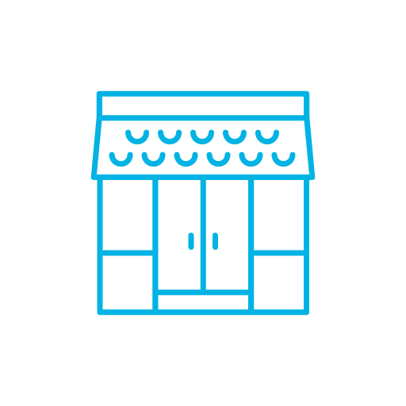

# Storefront

[](http://storefront123.s3-website-us-east-1.amazonaws.com)

[Link To Live Web](http://storefront123.s3-website-us-east-1.amazonaws.com)

<p>

Full stack app built with Postgres-Express-React-Nodejs Stack, hosted on [AWS](https://aws.amazon.com/), and use [CircleCI](https://circleci.com/) as CI/CD.

</p>

<p align="center">

</p>

## Table of content

- [Dependencies](./docs/dependencies.md)
- [Infrastructure](./docs/Infrastructure.md)
- [Pipeline](./docs/pipeline.md)
- [Project setup](#project-setup)
- [Available scripts](#available-scripts)
- Three tiers architecture 
    - [Database](#database)
    - [API](#api)
    - [UI](#ui)

## Tech stack

- DB
    - postgres
- API
    - NodeJs
    - Typescript
    - ExpressJs
- UI
    - ReactJs
    - AntD
- Hosted
    - AWS
- CI/CD
    - CircleCI

## Project setup

1. Clone the project `git clone https://github.com/IMM9O/udacity-storefront.git`.

2. Installation is done using the [npm install command](https://docs.npmjs.com/downloading-and-installing-packages-locally): `npm install`.

> **Note:** Install command will also install client&server dependencies

3. Install postgres on your local machine from this [link](https://www.postgresql.org/download/).

4. Open `Sql Shell` (psql).

5. Connect to the default postgres database user `psql -U postgres`.

6. In `psql` run the following to create the dev, test, and production databases.

```sql
/** DEV database **/
CREATE DATABASE storefront_dev;
/** Test database **/
CREATE DATABASE storefront_test;
/** Production database **/
CREATE DATABASE storefront_prod;
```

7. Setup database `npm run db:up`.

8. Seed the database with dummy data for testing:
   ```bash
   cd server && npm run seed
   ```

9. Make a copy for `.env.example` file to `.env` and then change the variables to match your environment.

> Don't forget to replace {database_password} with your current postgres password

```env
NODE_ENV=dev
DB_HOST=127.0.0.1
DB_USER=postgres
DB_PASSWORD={database_password}
DB_DATABASE_DEV=storefront_dev
DB_DATABASE_TEST=storefront_test
DB_DATABASE_PROD=storefront_prod
BCRYPT_PASSWORD=
SALT_ROUNDS=
TOKEN_SECRET=
```

9. To start the app run `npm start`.

> **Note:** This command will start both app the client and the server

## Docker Setup

### Prerequisites

- [Docker](https://www.docker.com/get-started)
- [Docker Compose](https://docs.docker.com/compose/install/)

### Quick Start

```bash
# Build and run all services
docker-compose up --build
```

This will start:
- **PostgreSQL** on port `5432`
- **Backend API** on port `3001`

### Manual Commands

```bash
# Build the backend image
docker-compose build

# Start services
docker-compose up

# Start services in detached mode
docker-compose up -d

# View logs
docker-compose logs -f backend

# Stop services
docker-compose down

# Seed the database (run after containers are up)
docker-compose exec backend npm run seed
```

### Database Access

Connect to PostgreSQL running in Docker:

```bash
# Using docker exec
docker-compose exec postgres psql -U postgres -d storefront_dev

# Using psql directly (ensure postgres is running locally)
psql -h localhost -U postgres -d storefront_dev
```

### Default Credentials

| Variable | Default Value |
|----------|---------------|
| DB_USER | postgres |
| DB_PASSWORD | postgres |
| DB_DATABASE_DEV | storefront_dev |

### Seed Data

Run the seed script to populate the database with test data:

```bash
cd server && npm run seed
```

This creates:
- 3 test users (password: `password123`)
- 8 products across different categories
- 3 orders with products attached

To view the data in the database:

```bash
psql -h localhost -U postgres -d storefront_dev
```

Then run SQL queries:

```sql
SELECT * FROM users;
SELECT * FROM products;
SELECT * FROM orders;
SELECT * FROM order_products;
\q
```

### Troubleshooting

```bash
# Reset database (removes all data)
docker-compose down -v

# Rebuild and start fresh
docker-compose up --build --force-recreate
```

### Environment Variables

To override defaults, create a `.env` file:

```env
POSTGRES_PASSWORD=your_password
DB_USER=your_user
DB_DATABASE_DEV=your_database
```

| **Database Port** | **Server Port** | **Client Port** |
|      :----:       |      :----:     |     :----:      |
|       5432        |       3001      |      3000       |

## Available scripts

- To start both frontend and backend app run `npm start` 
- To seed the database with test data run `npm run seed` (in server directory)
- To check app format run `npm run prettier`
- To check app error run `npm run lint`
- To test both frontend and backend app run `npm run test`
- To build both frontend and backend app run `npm run build`

## Database

For More information go to here => [Database](./docs/dependencies.md#database)

## APIs

For More information go to here => [REQUIREMENTS](./REQUIREMENTS.md)

<table>
    <th>
        <tr>
            <td>URL</td>
            <td>Type</td>
            <td>Token Required</td>
        </tr>
    </th>
    <tbody>
        <tr>
            <td>/api/products/</td>
            <td>GET</td>
            <td>❌</td>
        </tr>
        <tr>
            <td>/api/products/:id</td>
            <td>GET</td>
            <td>❌</td>
        </tr>
        <tr>
            <td>/api/products/</td>
            <td>POST</td>
            <td>✔</td>
        </tr>
        <tr>
            <td>/api/products/:id</td>
            <td>UPDATE</td>
            <td>✔</td>
        </tr>
        <tr>
            <td>/api/products/:id</td>
            <td>DELETE</td>
            <td>✔</td>
        </tr>
        <tr>
            <td>/api/users/</td>
            <td>GET</td>
            <td>✔</td>
        </tr>
        <tr>
            <td>/api/users/:id</td>
            <td>GET</td>
            <td>✔</td>
        </tr>
        <tr>
            <td>/api/users/</td>
            <td>POST</td>
            <td>❌</td>
        </tr>
        <tr>
            <td>/api/users/:id</td>
            <td>UPDATE</td>
            <td>✔</td>
        </tr>
        <tr>
            <td>/api/users/:id</td>
            <td>DELETE</td>
            <td>✔</td>
        </tr>
        <tr>
            <td>/api/users/:id/authenticate</td>
            <td>POST</td>
            <td>❌</td>
        </tr>
        <tr>
            <td>/api/orders/:userId</td>
            <td>GET</td>
            <td>✔</td>
        </tr>
        <tr>
            <td>/api/orders/completed/:userId</td>
            <td>GET</td>
            <td>✔</td>
        </tr>
        <tr>
            <td>/api/orders/active/:userId</td>
            <td>GET</td>
            <td>✔</td>
        </tr>
        <tr>
            <td>/api/orders/:id</td>
            <td>GET</td>
            <td>✔</td>
        </tr>
        <tr>
            <td>/api/orders/</td>
            <td>POST</td>
            <td>✔</td>
        </tr>
        <tr>
            <td>/api/orders/:id</td>
            <td>UPDATE</td>
            <td>✔</td>
        </tr>
        <tr>
            <td>/api/orders/:id</td>
            <td>DELETE</td>
            <td>✔</td>
        </tr>
        <tr>
            <td>/api/orders/:id/products</td>
            <td>POST</td>
            <td>✔</td>
        </tr>
        <tr>
            <td>/api/orders/:id/products</td>
            <td>GET</td>
            <td>✔</td>
        </tr>
    <tbody>
</table>

## UI

The UI built with the help of [create react app](https://create-react-app.dev/). For More information go to here => [UI](./docs/dependencies.md#ui)